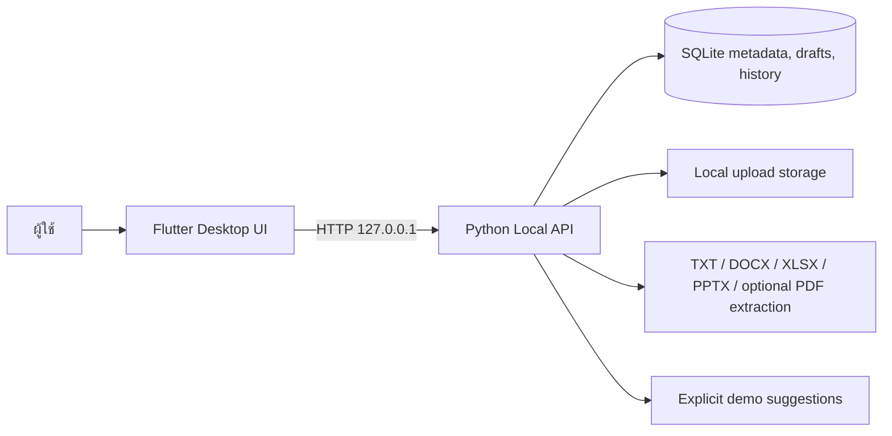

# Seqotia AI Document Workspace

Seqotia เป็นพื้นที่ทำงานเอกสารแบบ local-first สำหรับทดลองจัดเก็บ ค้นหา และสร้างเอกสาร PO, PR และใบแจ้งซ่อม มีหน้าจอ Flutter และ API ในเครื่องที่ใช้ SQLite โดยเก็บไฟล์ไว้นอก Source Code

> สถานะปัจจุบัน: vertical slice สำหรับการพัฒนาในเครื่อง ยังไม่ใช่ระบบองค์กรที่เปิดใช้งานหลายผู้ใช้หรือระบบอนุมัติจริง

## ฟีเจอร์ที่มีในชุดนี้

- Dashboard และสถิติที่อ่านจำนวนจากฐานข้อมูลจริง แสดงเวลา `Asia/Bangkok` และสถานะว่างเมื่อยังไม่มีข้อมูล
- Document Library แบบ List/Grid พร้อมค้นหา กรองประเภท ดู Metadata ประวัติ ย้ายโฟลเดอร์ บันทึกไฟล์ต้นฉบับ ประมวลผลซ้ำ และ Archive
- สร้าง Folder และ Subfolder, เปลี่ยนชื่อ, เปิดดูเอกสารใน Folder และป้องกันการย้าย Folder เข้าไปในตัวเองหรือ Descendant
- อัปโหลด PDF, DOCX, XLSX, PPTX และ TXT สูงสุด 25 MB ต่อไฟล์ (ปรับได้)
- Extract ข้อความจาก TXT และเอกสาร Office แบบ XML; PDF จะ Extract ได้เมื่อติดตั้ง PyMuPDF และ PDF มี selectable text
- Document Studio สำหรับ PO, PR และ Repair Request พร้อม Form Validation, รายการสินค้าหลายแถว และการคำนวณยอดรวมด้วย Decimal ฝั่ง Backend
- เก็บเอกสารที่สร้างใน Studio เป็น Draft; ระบบไม่สร้างเลข PO/PR และไม่อนุมัติเอกสารเอง
- AI Suggestion endpoint เป็น **ข้อความจำลอง** ที่ระบุแหล่งที่มาเป็น Demo ชัดเจน ไม่มีการเรียกโมเดลภายนอกหรือใช้เอกสารเก่ามาเติมข้อเท็จจริง
- API ในเครื่องใช้ Python standard library, SQLite และจัดเก็บ Upload ใน Local App Data โดยปริยาย

## สถาปัตยกรรม



## เทคโนโลยี

- Frontend: Flutter/Dart, Material 3, `dio`, `file_picker`
- Backend: Python 3.10+, `http.server`, `sqlite3`, ตัวประมวลผลไฟล์แยกตาม Format
- Database: SQLite พร้อม initial schema migration
- File storage: `%LOCALAPPDATA%\Seqotia\uploads` บน Windows; เก็บไฟล์ออกจาก Source Code
- AI: Demo provider แบบคงที่เท่านั้น ไม่มี OpenAI API Key หรือค่าใช้บริการ

## โครงสร้าง

```text
lib/                         Flutter UI, API client, routes, design system
backend/app/                 Local HTTP API, SQLite store, file processors
backend/migrations/          SQLite schema
backend/tests/               Unit และ HTTP smoke tests (unittest)
test/                        Flutter widget tests
.github/workflows/ci.yml     Flutter และ Python CI
```

## ข้อกำหนดก่อนเริ่ม

- Flutter SDK ที่มี Dart SDK `>=3.7.0` และ Windows Desktop tooling หากต้องการรันเป็น Windows app; เพิ่มโฟลเดอร์ `flutter\bin` ลงใน `PATH` แล้วเปิด PowerShell ใหม่
- การ Build Windows app ต้องติดตั้ง Visual Studio (ไม่ใช่ VS Code) พร้อม Workload `Desktop development with C++` ดู [คู่มือตั้งค่า Flutter สำหรับ Windows](https://docs.flutter.dev/platform-integration/windows/setup)
- Python 3.10 ขึ้นไป
- Git สำหรับ Repository ที่จะเผยแพร่

ในสภาพแวดล้อมที่ใช้เตรียม Source Code นี้ `flutter` และ `dart` ยังไม่ติดตั้ง จึงยังไม่ได้ Generate Windows Runner, Resolve Flutter packages, Analyze หรือรัน Flutter widget tests

## เริ่มใช้งานจาก VS Code

เปิดโฟลเดอร์ Repository ใน VS Code แล้วทำครั้งแรกเพียงครั้งเดียว:

1. เปิด `Terminal` → `Run Task...` → `Seqotia: Install prerequisites`
2. รอให้ติดตั้ง Flutter, Visual Studio C++ Build Tools (ถ้ายังไม่มี), Windows Runner และ Dependencies เสร็จ
3. ปิดแล้วเปิด VS Code ใหม่หนึ่งครั้ง เพื่อให้ Flutter SDK ที่เพิ่มใน `PATH` ถูกตรวจพบ
4. กด `F5` แล้วเลือก `Seqotia Windows`

Task `Seqotia: Start` จะเปิด Backend ให้เอง ตรวจสุขภาพ API สร้าง Windows Runner เมื่อยังไม่มี และเรียก `flutter pub get` ก่อนเริ่มแอป หากต้องการเปิด Backend อย่างเดียว ให้เลือก `Terminal` → `Run Task...` → `Seqotia: Backend` แล้วหยุดด้วย `Ctrl+C` ใน Terminal นั้น

การติดตั้งครั้งแรกดาวน์โหลด Flutter SDK และอาจติดตั้ง Visual Studio Build Tools ขนาดใหญ่ผ่าน `winget`; Windows อาจขอสิทธิ์ผู้ดูแลระบบสำหรับ Build Tools การรันครั้งถัดไปใช้ `F5` ได้เลย

## รัน Backend บน Windows PowerShell

จากโฟลเดอร์ Repository:

```powershell
.\run_backend.ps1
```

Launcher นี้ใช้ Python ที่ติดตั้งใน `PATH` ก่อน และจะลอง Python runtime ที่มากับ Codex หากไม่มี Python บน `PATH` วิธีนี้ใช้รัน API ได้ทันทีในสภาพแวดล้อม Codex เครื่องนี้ โดยไม่ต้องสร้าง Virtual Environment

หากต้องการสร้าง Virtual Environment ด้วย Python ที่ติดตั้งในเครื่อง:

```powershell
python --version
python -m venv .venv
.\.venv\Scripts\Activate.ps1
Copy-Item backend\.env.example backend\.env
python -m backend.app.main
```

Backend จะฟังที่ `http://127.0.0.1:8000` และสร้าง SQLite/Uploads ไว้ใต้ `%LOCALAPPDATA%\Seqotia` โดยปริยาย การรัน API และการทดสอบไม่ต้องติดตั้ง Python packages เพิ่ม

หากใช้คำสั่งแบบ Virtual Environment แล้ว `python --version` ไม่พบคำสั่ง ให้ติดตั้ง Python 3.10 ขึ้นไปและเพิ่ม Python ลงใน `PATH`; ในสภาพแวดล้อม Codex นี้สามารถใช้ `run_backend.ps1` โดยไม่ต้องสร้าง Virtual Environment

หากต้องการ Extract ข้อความจาก PDF ให้ติดตั้ง Optional Dependency:

```powershell
python -m pip install -r backend\requirements.txt
```

หากติดตั้ง PyMuPDF ไม่ได้ ไฟล์ PDF ยังถูกเก็บได้ แต่จะแสดงสถานะ `needs_review`; OCR เอกสารสแกนยังไม่รองรับ

ตัวแปรใน `backend\.env` ปรับ Host, Port และขนาดไฟล์ได้ ค่าเริ่มต้นปลอดภัยสำหรับเครื่องเดียว หากตั้ง Host ให้รับการเชื่อมต่อจากภายนอก ต้องตั้ง `SEQOTIA_ALLOW_REMOTE=1` เอง และ API รุ่นนี้ยังไม่มี Authentication จึงไม่ควรเปิดให้เครือข่ายอื่นเข้าถึง

## รัน Flutter บน Windows

ติดตั้ง Flutter SDK และ Windows Desktop tooling ตามข้อกำหนดด้านบน แล้วเปิด PowerShell ใหม่และยืนยันว่า `flutter doctor -v` ผ่าน Windows toolchain. เปิด PowerShell อีกหน้าต่างโดยให้ Backend ยังทำงานอยู่ ก่อนสร้าง Runner ครั้งแรก:

```powershell
flutter create --platforms=windows --project-name seqotia .
flutter pub get
flutter run -d windows --dart-define=SEQOTIA_API_BASE_URL=http://127.0.0.1:8000
```

`flutter create` ใช้เพิ่ม Windows platform scaffold ให้ Source ที่เริ่มจากโฟลเดอร์ว่าง รัน `flutter pub get` และตรวจไฟล์ที่สร้างก่อน Commit

ถ้ารัน Backend บน Port หรือ Host อื่น ให้เปลี่ยน `SEQOTIA_API_BASE_URL` ตอน Run เช่น:

```powershell
flutter run -d windows --dart-define=SEQOTIA_API_BASE_URL=http://127.0.0.1:8010
```

## ทดสอบ

Backend tests ใช้ Python standard library:

```powershell
python -m compileall -q backend
python -m unittest discover -s backend/tests -v
```

หลังติดตั้ง Flutter และ Generate platform scaffold แล้ว:

```powershell
dart format lib test
flutter analyze
flutter test
```

GitHub Actions รันคำสั่ง Flutter เหล่านี้และ Python API/unit tests ใน CI

## ข้อจำกัดที่ยังเหลือ

- ไม่มี Authentication, User/Role/Permission enforcement หรือ Approval workflow; `/login` เป็นหน้าเข้าโหมดทดลองเท่านั้น
- Local API ไม่มี FastAPI dependency เพื่อให้รันและทดสอบได้โดยไม่ติดตั้งบริการเพิ่ม และตั้งใจ Bind ที่ Loopback
- Backend ใช้ SQLite; ยังไม่มี PostgreSQL, Qdrant, Alembic migration chain หรือ semantic search
- PDF extraction ต้องติดตั้ง PyMuPDF; OCR ภาษาไทย, การตรวจเอกสารสแกน และการสกัดข้อมูลจากตารางที่ซับซ้อนยังไม่ทำ
- AI Provider จริง, RAG, Source References, Prompt Injection defense pipeline และการเรียนรู้จาก Feedback ยังไม่เชื่อมต่อ; Demo Suggestions ไม่ใช่คำแนะนำจากโมเดล
- Template Registry ปัจจุบันเป็นแม่แบบระบบแบบอ่านอย่างเดียว; ยังไม่มีหน้าสร้างหรือแก้ไข Template/Approval Rules
- Preview แสดง Metadata และข้อความที่สกัดได้; ยังไม่มี PDF renderer หรือการแสดงเอกสาร Office แบบหน้าเอกสาร
- ไม่มี Push Notification, Approval Task, Audit identity หรือการซิงก์ข้ามผู้ใช้
- Flutter SDK ไม่อยู่ใน Environment ที่ใช้เตรียมงานนี้ จึงยังตรวจ Compile, Layout overflow และการทำงานของ Windows Plugin จริงไม่ได้

## ความปลอดภัยและข้อมูล

- อย่าใส่ API Key, Password, เอกสารจริง หรือ Credentials ลง Source Code หรือ Test Fixtures
- SQLite และไฟล์อัปโหลดเก็บอยู่นอก Repository; `.gitignore` กันไฟล์ local database, Uploads และ `.env`
- API ไม่บันทึก request body หรือ extracted text ลง Log และตอบข้อผิดพลาดโดยไม่คืน stack trace
- Backend จำกัด Extension, MIME, File Size, Office archive size, path traversal และชื่อไฟล์; การป้องกันนี้ไม่ทดแทน Malware Scanning
- API ปัจจุบันไม่มี Authentication และควรใช้เฉพาะ Local Development จนกว่าจะเพิ่ม identity, permissions และ secure deployment

## เตรียม GitHub

Repository นี้เริ่มจากโฟลเดอร์ว่างและยังไม่มี Remote; งานนี้ไม่ Push และไม่สร้าง Commit ให้ ตรวจไฟล์ก่อนเพิ่ม GitHub Remote:

```powershell
git status --short --branch
git diff --check
git ls-files --others --exclude-standard
```

เมื่อสร้าง GitHub Repository แล้ว จึงกำหนด URL จริงที่ได้รับจาก GitHub และ Push ด้วยตนเอง:

```powershell
git remote add origin <GITHUB_REPOSITORY_URL>
git add .
git status --short
git diff --cached --check
git commit -m "Build Seqotia document workspace MVP"
git push -u origin main
```

อย่าเพิ่ม `.env`, ฐานข้อมูล หรือโฟลเดอร์ Uploads เข้า Git โดยเด็ดขาด
